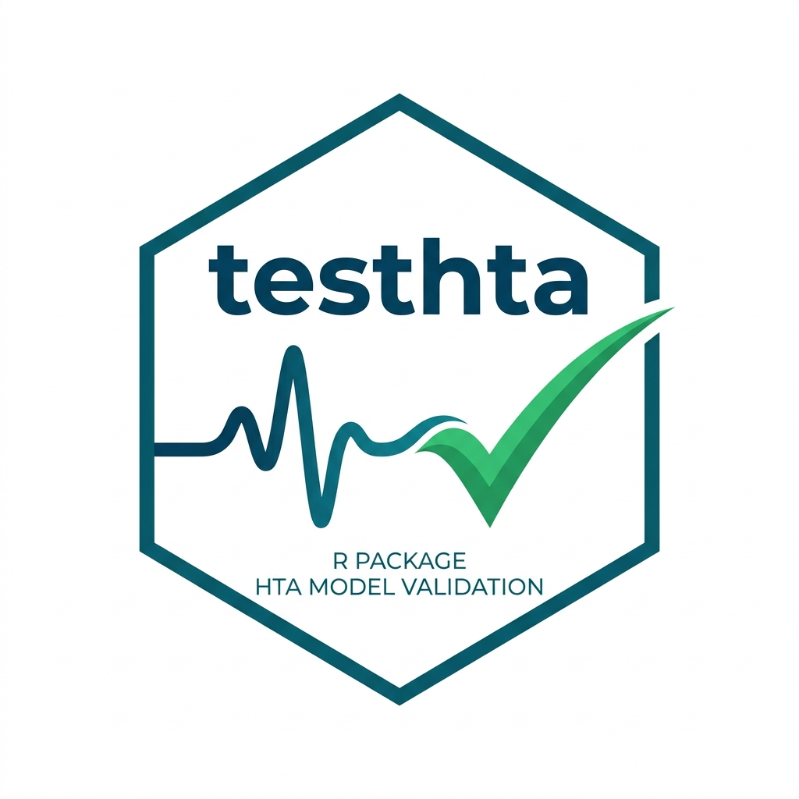

# testhta 

<!-- badges: start -->
[](https://github.com/validate-hta/testhta/actions)
[](https://www.gnu.org/licenses/gpl-3.0)
[](https://lifecycle.r-lib.org/articles/stages.html#experimental)
<!-- badges: end -->

**Automated Verification and Unit Testing for Health Economic and HTA Models in R**

`testhta` provides a practical, software-engineering-inspired framework for applying **automated verification** (unit, integration, and system testing) to health economic and health technology assessment (HTA) models in R. Built around the [`testthat`](https://testthat.r-lib.org/) package, `testhta` accompanies the tutorial paper *"Automated Verification for Health Economic Models in R: A Hands-On Tutorial"* (Green, Gallardo, & Lamrock, 2026) and includes a complete 3-state discrete-time cohort Markov model case study and verification test suite.

Ensuring HTA model quality should not rely solely on ad-hoc console checks or manual spreadsheet audits. `testhta` makes verification automated, reproducible, and transparent—proactively catching silent logic bugs before they influence reimbursement decisions.

---

## Key Features

- 🧪 **Custom Verification Expectations**: High-level wrapper expectations (`check_model_qalys()`, `check_model_costs()`, `check_model_le()`, `check_model_le_pp()`) to verify model outputs against expected boundary values.
- 🔄 **Relational Model Comparators**: Compare outputs across parameter configurations using `compare_model_runs()` (e.g., verifying that positive discounting reduces future QALYs and costs, or that removing intervention costs reduces the ICER).
- 🔗 **Modular Helper Interface**: Isolate model internals from test scripts using getters (`get_qalys()`, `get_costs()`, `get_le()`, `get_le_pp()`, `get_icer()`) and pipe-friendly setters (`set_discount_rate()`, `set_time_horizon()`, `set_costs()`, `set_utilities()`, `set_p_matrix()`) alongside the `run_model()` wrapper.
- ⚙️ **Executable Case Study & Scaffolding**: Includes the 3-state (`Asymptomatic`, `Progressive`, `Dead`) cohort Markov model (`ce_markov()`), baseline parameters (`base_params`), end-to-end tutorial test script (`inst/tutorial-paper/run-model-tests.R`), and `use_hta_unittests()` to scaffold the test suite in your own project.

---

## Installation

You can install the development version of `testhta` from GitHub:

```r
# install.packages("devtools")
devtools::install_github("validate-hta/testhta")
```

---

## Quick Start: Build, Run, and Verify

Here is a basic example demonstrating how to run the cohort Markov model case study and verify economic discounting logic.

### 1. Set Up and Run the Model

We use the package's built-in baseline parameter list `base_params` (a cohort of $n = 1000$ patients simulated over $n_{\text{cycles}} = 15$ cycles at a $3.5\%$ discount rate) to execute the cost-effectiveness model.

```r
library(testhta)

# Load baseline parameters
data(base_params)

# Run the Markov simulation
results <- run_model(base_params)

# Extract key HTA outputs using getters
get_qalys(results)
#> without_drug    with_drug 
#>     8394.580     8981.496 

get_costs(results)
#> without_drug    with_drug 
#>      1147099      4865536 

get_le_pp(results)
#> without_drug    with_drug 
#>     12.06416     12.68332 

get_icer(results)
#> [1] 6335.546
```

### 2. Modify Parameters with Pipe Setters

Easily perform scenario analyses or sensitivity sweeps by piping parameter modifications:

```r
# Evaluate a 10-cycle time horizon with no discounting
scenario_results <- base_params |>
  set_time_horizon(10) |>
  set_discount_rate(0) |>
  run_model()

get_icer(scenario_results)
#> [1] 11902.39
```

### 3. Automated Verification Assertions

`testhta` integrates directly with `testthat` to express verification checks from the HTA Test Registry (`T01`–`T12`):

```r
library(testthat)

# T06: Verify that QALYs with standard discounting (3.5%) are strictly less
# than QALYs without discounting (0%)
compare_model_runs(
  extractor_fn = get_qalys,
  comparison_fn = expect_lt,
  params_1 = list(discount_rate = 0.035),
  params_2 = list(discount_rate = 0),
  data = base_params,
  label = "T06: Discounted should be less than undiscounted QALYs"
)
```

---

## The HTA Verification Test Registry (T01 – T12)

The verification checks in `testhta` operationalize established HTA quality-assurance frameworks (McCabe & Dixon, 2000; Tappenden & Chilcott, 2014; Dasbach & Elbasha, 2017; CHEERS) across **12 core test scenarios (`T01`–`T12`)** grouped into four domains:

- **Population Tests (`T01`–`T03`)**: Equal treatment effects yield equal LYGs and QALYs (`T01`); zero mortality yields life expectancy equal to the time horizon (`T02`); immediate 100% mortality yields life expectancy of 1 cycle (`T03`).
- **QALY Tests (`T04`–`T07`)**: Zero discount rate with living utilities $= 1$ yields total QALYs equal to LE (`T04`); living utilities $= 1$ yields QALY gains equal to LYGs (`T05`); positive discount rate reduces QALYs (`T06`); infinite/extreme discount rate reduces QALY gains after time 0 to zero (`T07`).
- **Cost Tests (`T08`–`T11`)**: Zero intervention cost reduces ICER (`T08`); increased intervention cost increases ICER (`T09`); zero vs. positive cost discounting (`T10`); infinite/extreme cost discount rate reduces costs after time 0 to zero (`T11`).
- **Input / PSA Tests (`T12`)**: Stochastic parameter samples drawn for Probabilistic Sensitivity Analysis (PSA) respect distribution domain boundaries (e.g., Beta utility draws strictly in $(0, 1)$ using `withr::with_seed()`).

For the complete test matrix, step-by-step code examples, custom expectations, and AI-assisted testing workflows (`model-context.md`), see the package vignettes:
- [**Introduction to testhta & Case Study Model**](https://validate-hta.github.io/testhta/articles/introduction.html)
- [**The HTA Verification Framework (T01–T12)**](https://validate-hta.github.io/testhta/articles/verification-framework.html)
- [**R Test Code Examples (Discounting, Costs, Population)**](https://validate-hta.github.io/testhta/articles/basic-tests.html)
- [**Custom Expectations & Stochastic PSA Testing**](https://validate-hta.github.io/testhta/articles/validation-guide.html)
- [**Automating Tests & AI-Assisted Verification**](https://validate-hta.github.io/testhta/articles/automating-hta-unit-tests.html)

---

## References

1. **Green, N., Gallardo, D., & Lamrock, F.** (2026). Automated Verification for Health Economic Models in R: A Hands-On Tutorial. (See `inst/tutorial-paper/Validation_Testing_HE_Models_Tutorial.pdf`).
2. **McCabe, C., & Dixon, S.** (2000). Testing the Validity of Cost-Effectiveness Models. *PharmacoEconomics*, 17(5), 501–513. [https://doi.org/10.2165/00019053-200017050-00007](https://doi.org/10.2165/00019053-200017050-00007)
3. **Tappenden, P., & Chilcott, J. B.** (2014). Avoiding and Identifying Errors and Other Threats to the Credibility of Health Economic Models. *PharmacoEconomics*, 32, 967–979. [https://doi.org/10.1007/s40273-014-0186-2](https://doi.org/10.1007/s40273-014-0186-2)
4. **Dasbach, E. J., & Elbasha, E. H.** (2017). Verification of Decision-Analytic Models for Health Economic Evaluations: An Overview. *PharmacoEconomics*, 35, 673–683. [https://doi.org/10.1007/s40273-017-0508-2](https://doi.org/10.1007/s40273-017-0508-2)
5. **Alarid-Escudero, F., et al.** (2019). A Need for Change! A Coding Framework for Improving Transparency in Decision Modeling. *PharmacoEconomics*, 37(11), 1329–1339. [https://doi.org/10.1007/s40273-019-00837-x](https://doi.org/10.1007/s40273-019-00837-x)
